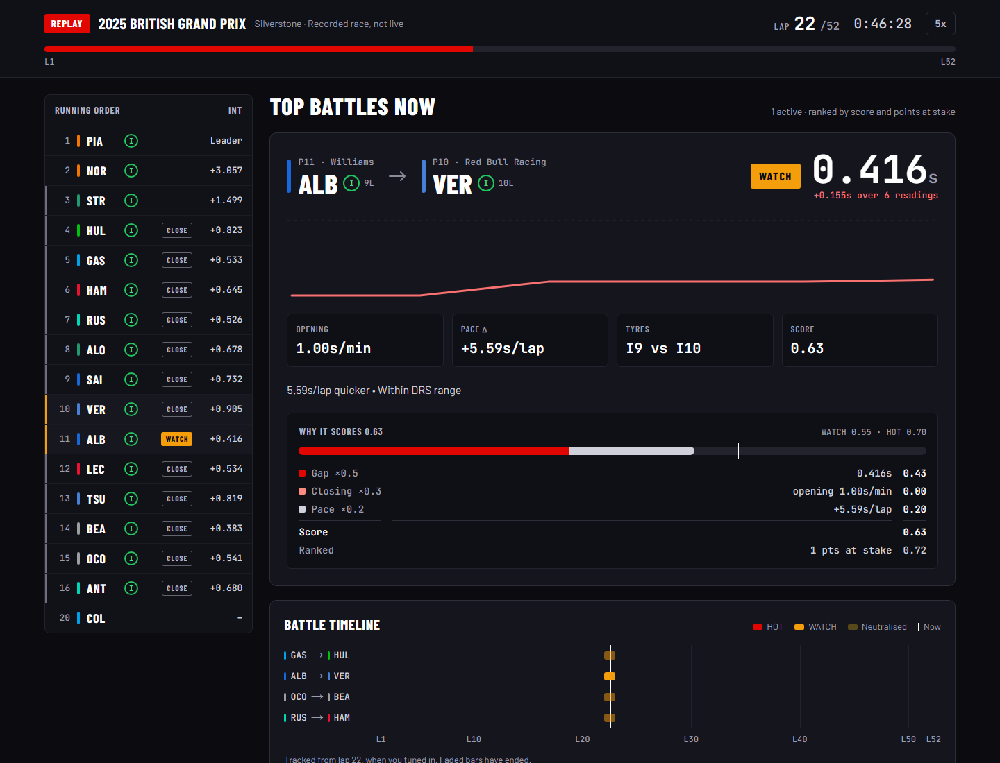

# F1 Battle Detector

A Formula 1 race replay that finds the battles worth watching. Real 2025 races
play back on a loop, and at every moment the dashboard ranks the hottest
on-track battles, explains why each one scores the way it does, and draws a
timeline of every battle in the race so far. Race data comes from
[OpenF1](https://openf1.org), cached so the deployed demo never calls it.



## Features

- 🏁 Race replay: six real 2025 Grands Prix at 5x on a loop, every viewer
  watching the same moment
- 🔥 Hottest battles now, scored on gap, closing rate and pace advantage, and
  ranked higher when more points are at stake
- 🧮 A breakdown of every score, so you can see why a battle ranks where it does
- 📈 A battle timeline across the whole race, with gap trend sparklines
- 🚦 Safety car, VSC and red flag awareness: no battles shown while the field is
  neutralised
- 📱 Mobile-first responsive design
- 📡 The same pipeline can run on OpenF1 live timing (`DATA_MODE=live`), or on a
  scripted mock race for development (`DATA_MODE=mock`)

## Architecture

**Backend**: Python + FastAPI

- Replays cached races on the same 1.5 s grid a live poller would see
- Maintains driver state with rolling history
- Detects and scores battles with context awareness (track status, pit stops,
  points at stake)
- Exposes a REST API under `/api`

**Frontend**: Next.js + React + TypeScript

- Dashboard refreshed every few seconds with SWR
- Modern UI with TailwindCSS

**Data Source**: [OpenF1 API](https://openf1.org). Historical races are free and
are cached into the repo; live timing needs a paid Sponsor-tier token.

## Prerequisites

- Python 3.11+
- Node.js 18+
- Docker (optional, for containerized deployment)

## Quick Start (Development)

### Option 1: Docker Compose (Recommended)

One container: the dashboard exported to static files and served by FastAPI at
`/`, the API at `/api`, and the cached races baked in. It plays the replay
broadcast out of the box; no `.env` is needed.

```bash
git clone <your-repo-url>
cd F1-Battle-Detector-Summarizer
docker compose up --build

# Dashboard: http://localhost:8000
# API docs:  http://localhost:8000/api/docs
```

`DATA_MODE=mock docker compose up` plays the scripted mock race instead.

### Option 2: Manual Setup

**Backend:**

```bash
cd backend

# Create virtual environment
python -m venv venv
source venv/bin/activate  # On Windows: venv\Scripts\activate

# Install dependencies
pip install -r requirements.txt

# Copy .env file
cp .env.example .env

# Run server
uvicorn app.main:app --reload --host 0.0.0.0 --port 8000
```

**Frontend:**

```bash
cd frontend

# Install dependencies
npm install

# Copy .env file
cp .env.local.example .env.local

# Run dev server - proxies /api to the backend on :8000
npm run dev
```

## Project Structure

```bash
F1-Battle-Detector-Summarizer/
├── .github/workflows/ci.yml  # Backend tests, frontend lint and build
├── backend/
│   ├── app/
│   │   ├── main.py           # FastAPI app, polling loops, endpoints
│   │   ├── openf1_client.py  # OpenF1 API wrapper
│   │   ├── models.py         # Pydantic data models
│   │   ├── state.py          # In-memory state manager
│   │   ├── battle.py         # Battle detection and scoring
│   │   ├── session.py        # Session lifecycle
│   │   ├── health.py         # Health monitoring
│   │   ├── mock_data.py      # DATA_MODE=mock data generator
│   │   ├── demo.py           # Mock mode without a poll loop (serverless)
│   │   ├── ingest.py         # `python -m app.ingest` - cache a race
│   │   ├── replay/
│   │   │   ├── store.py      # The on-disk race cache and its manifests
│   │   │   ├── timeline.py   # Cached endpoints -> one event stream
│   │   │   ├── engine.py     # One race stepped on the live poll grid
│   │   │   └── broadcast.py  # The shared replay schedule, rebuilt per request
│   │   ├── sources/          # live, mock and replay DataSources
│   │   └── config.py         # Configuration
│   ├── data/sessions/        # Cached races, one directory per session_key
│   ├── api/index.py          # Vercel entrypoint (ASGI)
│   ├── vercel.json
│   ├── tests/                # Unit and integration tests
│   ├── requirements.txt
│   └── requirements-dev.txt
├── frontend/
│   ├── app/
│   │   ├── components/       # React components
│   │   ├── hooks/            # Custom SWR hooks
│   │   ├── lib/              # API client
│   │   ├── types/            # TypeScript types
│   │   └── page.tsx          # Main dashboard
│   └── package.json
├── Dockerfile                # One image: static dashboard + API + races
├── docker-compose.yml
├── docs/DEPLOY-VERCEL.md     # Deploying both halves to Vercel
├── PLAN.md                   # Detailed implementation plan
└── README.md
```

## API Endpoints

Everything is under `/api`, docs included (`/api/docs`), so that the container
path can serve the frontend at `/` from the same origin.

### Session

- `GET /api/session/current` - The current session. In replay, the race on air
  with its real lap count (`current_lap` / `total_laps`)

### Race Data

- `GET /api/state/latest` - All 20 drivers' current state
- `GET /api/battles/top?k=5` - Top K battles ranked by score
- `GET /api/drivers/{driver_number}/trend?points=10` - Gap trend for a driver

### Replay

- `GET /api/replay/status` - Where the broadcast is: race, race time, lap, track
  status, speed, progress and the next race. Outside replay mode only `mode` is set
- `GET /api/replay/sessions` - Every cached race, from its manifest

### System

- `GET /api/health` - Health check, plus the data mode and, in replay, the
  broadcast position and cache schema version

## Testing

**Backend:**

```bash
cd backend
pytest tests/ -v
```

**Frontend:**

There are no frontend tests yet. `npm run lint` and `npm run build` are what CI
runs, and the build type-checks the whole app:

```bash
cd frontend
npm run lint
npm run build
```

(`npm test` is declared in `package.json` but points at a jest that is not
installed.)

## Caching a race for replay

Historical OpenF1 data is free and needs no token. `app.ingest` fetches one
race's endpoints and stores them compressed under `backend/data/sessions/`,
so replay never depends on OpenF1 at runtime:

```bash
cd backend
python -m app.ingest --year 2025 --round 14     # Nth race of the season by date
python -m app.ingest --session-key 9693         # or by OpenF1 session key
python -m app.ingest --list                     # what is already cached
python -m app.ingest --refresh-playback         # re-store schedules, offline
```

Each run prints rows and compressed size per endpoint, which is what decides
how many races fit inside the deployed bundle. A full race is about **390 KB**
compressed - the 2025 Hungarian GP is 29,440 rows, 92% of them `intervals` -
so a playlist of 5-8 races costs 2-3 MB.

A few things it will not do. It refuses a session that ended less than 45
minutes ago, because OpenF1's free archive has not settled yet and the result
would be a partial race that looks complete. It fetches endpoints one at a
time with a pause between them - there is no published free-tier rate limit,
so the strategy is to be polite. And it fetches each race exactly once: a
second run over an already-cached race makes no requests at all, and `--force`
re-fetches but still writes nothing if the data has not changed.

The Grand Prix's name ("Hungarian Grand Prix") isn't on OpenF1's session
rows, so ingest makes one `/meetings` request for it. Re-running ingest on a
race cached without a name fills it in, without re-fetching anything else.

`car_data` and `location` are deliberately not fetched. That telemetry is
orders of magnitude larger than everything else combined and nothing reads it.

If the fetch fails with a certificate error, something on your machine is
intercepting TLS. Point `OPENF1_CA_BUNDLE` at its CA certificate.

## Replaying a cached race

```bash
cd backend
DATA_MODE=replay uvicorn app.main:app --reload
```

`DATA_MODE=replay` plays the cached races (`REPLAY_PLAYLIST`, or every cached
race) on a loop through the same pipeline live data uses. It works like a TV
channel: there is one broadcast, and where it is depends only on the wall
clock (`REPLAY_EPOCH`, `REPLAY_SPEED`), so every viewer and every server
instance shows the same moment of the same race.

Every 1.5 race-seconds, replay hands the pipeline exactly what a live poll at
that instant would have returned: the latest position and gap row per driver,
and lap times only once a live poller would have refreshed them. A test
proves it: eight laps of the 2025 Hungarian GP go through a fake OpenF1 to
`LiveSource` and through replay, and the battles match at every tick. Two
more things replay knows that live polling does not: when a car has retired
(it leaves the running order), and the track status from race control, so
safety car periods show no battles.

Under `DEMO_STATELESS` (serverless), each request rebuilds the broadcast's
current moment instead: 60 ticks to fill driver history, then the last
`REPLAY_WINDOW_TICKS` detected, ~40 ms. Across a full race that rebuild
reports the same battles as a server that has run since lights out; only
`duration_updates` can come out lower. Red-flag stoppages play back in
`REPLAY_QUIET_PLAYBACK_S` seconds rather than as a frozen screen.

## Deployment

### Vercel (both halves, replay on a loop)

Two Vercel projects from this repo - `backend/` and `frontend/` - playing six
real 2025 races (Bahrain, Austria, Britain, Belgium, Hungary and São Paulo) at
5x on a loop. The races ship inside the backend function (2.2 MB), so there are
no OpenF1 calls at runtime, no token and no always-on process. Step by step in
[docs/DEPLOY-VERCEL.md](./docs/DEPLOY-VERCEL.md).

The one thing to know: Vercel freezes the process between requests, so nothing
can keep a replay running. Instead, where the broadcast is depends only on the
wall clock, and each request rebuilds that moment into a throwaway pipeline:
~30 ms warm, every viewer seeing the same race. See
`backend/app/replay/broadcast.py`.

### Docker

The root `Dockerfile` is the whole app in one image - see Option 1 above. Any
host that runs a container will do.

### Live data

`DATA_MODE=live` needs a process that stays alive to poll, which serverless is
not. Run the image with `DATA_MODE=live` on a container host such as
[Render](https://render.com).

## Configuration

Key environment variables (see `.env.example` files):

**Backend:**

- `OPENF1_BASE_URL` - OpenF1 API endpoint
- `POLL_POSITIONS_INTERVAL_S` - Position polling frequency (default: 1.5s)
- `BATTLE_WATCH_SCORE` - Threshold for "WATCH" battles (default: 0.55)
- `BATTLE_HOT_SCORE` - Threshold for "HOT" battles (default: 0.70)
- `DATA_MODE` - Where driver data comes from: `live`, `replay` or `mock` (default: `mock`)
  - `mock` - generated data, never touches the network. What CI runs.
  - `live` - OpenF1 live timing; needs `OPENF1_API_TOKEN` (paid Sponsor tier)
  - `replay` - cached historical races on a loop; see "Replaying a cached race"
- `OPENF1_API_TOKEN` - Sponsor-tier token, required only for `DATA_MODE=live`
- `TEST_MODE` - Deprecated alias for `DATA_MODE`. Honoured only when `DATA_MODE`
  is unset (`true` maps to `mock`, `false` to `live`) and warns at startup.
- `DEMO_STATELESS` - Serve mock data per request instead of from a background
  poll loop. Defaults on when `VERCEL` is set, off everywhere else.
- `DEMO_WINDOW_TICKS` - Ticks of mock race replayed per request (default: 48)
- `CORS_ORIGIN_REGEX` - Origin pattern to allow alongside `CORS_ORIGINS`, for
  preview deployments whose hostname changes on every push
- `REPLAY_DATA_DIR` - Where cached races live (default: `./data/sessions`,
  relative to `backend/`)
- `INGEST_MIN_SESSION_AGE_MIN` - Minutes after a session ends before `app.ingest`
  will fetch it (default: 45)
- `REPLAY_QUIET_GAP_S` - Race-time silence that counts as a stoppage (default: 60s)
- `REPLAY_PLAYLIST` - Session keys to play in order, comma separated (default:
  every cached race)
- `REPLAY_SPEED` - Race seconds per wall second (default: 5)
- `REPLAY_EPOCH` - When the playlist started; fixes where the broadcast is
  (default: `2026-01-01T00:00:00+00:00`)
- `REPLAY_WINDOW_TICKS` - Ticks detected per request on the stateless path
  (default: 48)
- `REPLAY_QUIET_PLAYBACK_S` - Wall seconds a stoppage plays back in (default: 5)
- `OPENF1_CA_BUNDLE` - CA bundle to verify OpenF1's certificate against. Only
  needed behind something that intercepts TLS (a corporate proxy, or antivirus
  doing HTTPS scanning), which presents its own certificate
- `OPENF1_RETRY_BASE_S` - First wait between retries, doubling each time; a
  429's `Retry-After` overrides it (default: 2)
- `FRONTEND_DIR` - Exported frontend to serve at `/` (set in the Docker image;
  unset elsewhere)

`backend/.env` is read on startup. Real environment variables take precedence,
so `DATA_MODE=mock uvicorn app.main:app` overrides the file.

**Frontend:**

- `NEXT_PUBLIC_API_BASE_URL` - Backend API URL. Empty means same origin: the
  dev server proxies `/api` to `BACKEND_URL` (default `http://localhost:8000`),
  and the Docker image serves both. Set it on Vercel, where the API is a
  separate project.

## Development Status

Working end to end. The backend replays cached races, detects and scores
battles, and serves them over REST; the frontend shows the broadcast.

- ✅ Battle detection and scoring
- ✅ OpenF1 polling loops (positions, intervals, laps, session)
- ✅ Frontend dashboard
- ✅ Docker setup and CI
- ✅ Race ingest and cache (`python -m app.ingest`)
- ✅ Replay timeline builder
- ✅ Replay playback (`DATA_MODE=replay`), container and serverless
- ✅ `/api` routes, replay status and cached-race endpoints
- ✅ Replay UI: header, race clock, track status banner, tyres and team colours
- ✅ Deployment packaging: replay on Vercel, one-image Docker (1.7)
- ✅ Replay tests, including every shipped race checked for battles under a safety car (1.8)
- ✅ Verified on preview and production (1.9)
- ✅ 322 backend tests

Known limits:

- Opening laps under-detect. Before any driver completes a lap there is no pace
  delta, which caps the score below the `WATCH` threshold.
- No frontend tests. `next build` type-checks the app in CI; that is all.
- Blue flag situations are not detected. Battles are paired by adjacent
  classified position, and lapped cars are never adjacent to the car lapping
  them, so it would need pairing by track position.

See [PLAN.md](./PLAN.md) for the original roadmap.

## Contributing

This is a personal project, but suggestions and feedback are welcome! Open an issue to discuss major changes.

## License

MIT

## Acknowledgments

- [OpenF1](https://openf1.org) for the amazing free F1 data API
- Formula 1 community for inspiration

---

**Note**: PLAN.md is the original design document and describes some features that
were never built. This README describes what the code actually does.
